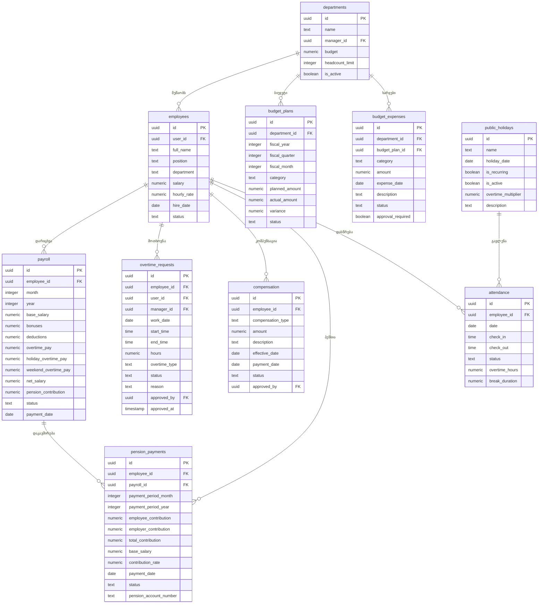

# ფინანსური სისტემის Database Schema

## 📊 არქიტექტურის დიაგრამა



## 🔐 RLS პოლიტიკების სქემა

```mermaid
graph TB
    subgraph "Admin/HR Roles"
        Admin[Admin]
        HR[HR Manager]
    end
    
    subgraph "Manager Role"
        Manager[Department Manager]
    end
    
    subgraph "Employee Role"
        Employee[Employee]
    end
    
    subgraph "Payroll Access"
        Admin -->|FULL CRUD| PayrollTable[payroll]
        HR -->|FULL CRUD| PayrollTable
        Employee -->|VIEW OWN| PayrollTable
    end
    
    subgraph "Overtime Access"
        Admin -->|FULL CRUD| OvertimeTable[overtime_requests]
        HR -->|FULL CRUD| OvertimeTable
        Manager -->|APPROVE/REJECT| OvertimeTable
        Employee -->|CREATE + VIEW OWN| OvertimeTable
    end
    
    subgraph "Compensation Access"
        Admin -->|FULL CRUD| CompTable[compensation]
        HR -->|FULL CRUD| CompTable
        Employee -->|VIEW OWN| CompTable
    end
    
    subgraph "Holidays Access"
        Admin -->|FULL CRUD| HolidaysTable[public_holidays]
        HR -->|FULL CRUD| HolidaysTable
        Employee -->|VIEW ACTIVE| HolidaysTable
        Manager -->|VIEW ACTIVE| HolidaysTable
    end
    
    subgraph "Pension Access"
        Admin -->|FULL CRUD| PensionTable[pension_payments]
        HR -->|FULL CRUD| PensionTable
        Employee -->|VIEW OWN| PensionTable
    end
    
    subgraph "Budget Access"
        Admin -->|FULL CRUD| BudgetTable[budget_plans + expenses]
        HR -->|FULL CRUD| BudgetTable
        Manager -->|CREATE + VIEW DEPT| BudgetTable
    end
```



## 📋 ცხრილების კატალოგი

### 1. **payroll** (ხელფასები)
**მიზანი:** ყოველთვიური ხელფასების დარიცხვა და გადახდა

**მთავარი ველები:**
- `base_salary` - საბაზო ხელფასი
- `bonuses` - ბონუსები
- `deductions` - დაკავებები
- `overtime_pay` - რეგულარული ზეგანაკვეთური
- `holiday_overtime_pay` - დღესასწაულების ზეგანაკვეთური
- `weekend_overtime_pay` - შაბათ-კვირის ზეგანაკვეთური
- `pension_contribution` - პენსიის შენატანი (2%)
- `net_salary` - წმინდა ხელფასი

**უნიკალური შეზღუდვა:** `employee_id + month + year`

**RLS:**
- ✅ Admin/HR: სრული წვდომა
- ✅ Employee: მხოლოდ საკუთარი ნახვა

---

### 2. **overtime_requests** (ზეგანაკვეთური)
**მიზანი:** ზეგანაკვეთური სამუშაოს მოთხოვნები და დამტკიცება

**მთავარი ველები:**
- `work_date` - სამუშაო თარიღი
- `hours` - საათების რაოდენობა
- `overtime_type` - ტიპი (weekday, weekend, holiday, night)
- `status` - სტატუსი (pending, approved, rejected)

**ტიპები და მულტიპლიკატორები:**
- `weekday` - სამუშაო დღე (x1.5)
- `weekend` - შაბათ-კვირა (x2.0)
- `holiday` - დღესასწაული (x2.0)
- `night` - ღამის ცვლა (დამატებითი)

**RLS:**
- ✅ Admin/HR: სრული წვდომა
- ✅ Manager: დამტკიცება/უარყოფა
- ✅ Employee: შექმნა + საკუთარი ნახვა

---

### 3. **compensation** (კომპენსაციები)
**მიზანი:** ბონუსები, კომისიები და დამატებითი ანაზღაურება

**მთავარი ველები:**
- `compensation_type` - ტიპი (bonus, commission, allowance, award, other)
- `amount` - თანხა
- `effective_date` - ძალაში შესვლის თარიღი
- `status` - სტატუსი (pending, approved, paid, cancelled)

**RLS:**
- ✅ Admin/HR: სრული წვდომა
- ✅ Employee: მხოლოდ საკუთარი ნახვა

---

### 4. **public_holidays** (საჯარო დღესასწაულები)
**მიზანი:** ოფიციალური არასამუშაო დღეების მართვა

**მთავარი ველები:**
- `holiday_date` - დღესასწაულის თარიღი
- `is_recurring` - განმეორებადი (ყოველწლიურად)
- `overtime_multiplier` - ზეგანაკვეთურის მულტიპლიკატორი (default: 2.0)
- `is_active` - აქტიური

**RLS:**
- ✅ Admin/HR: სრული წვდომა
- ✅ ყველა: მხოლოდ აქტიური დღესასწაულების ნახვა

---

### 5. **pension_payments** (საპენსიო გადახდები)
**მიზანი:** საპენსიო ფონდის შენატანების აღრიცხვა

**მთავარი ველები:**
- `employee_contribution` - თანამშრომლის შენატანი (2%)
- `employer_contribution` - დამსაქმებლის შენატანი
- `total_contribution` - ჯამური (ავტომატურად)
- `contribution_rate` - შენატანის განაკვეთი (default: 0.02)
- `pension_account_number` - საპენსიო ანგარიში

**უნიკალური შეზღუდვა:** `employee_id + payment_period_month + payment_period_year`

**RLS:**
- ✅ Admin/HR: სრული წვდომა
- ✅ Employee: მხოლოდ საკუთარი ნახვა

---

## 🔄 ინტეგრაციები და მონაცემთა ნაკადი

### ხელფასის დარიცხვის პროცესი:
```
1. attendance (დასწრება) 
   ↓
2. overtime_requests (ზეგანაკვეთური)
   ↓
3. public_holidays (დღესასწაულები)
   ↓
4. 🔧 src/lib/financialCalculations.ts
   ├─ calculateFullPayroll()
   │  ├─ calculateHourlyRate()
   │  ├─ calculateOvertimeBonus() (x1.5)
   │  ├─ calculateHolidayOvertimeBonus() (x2.0)
   │  ├─ calculatePensionContribution() (2% + 2%)
   │  └─ calculateIncomeTax() (20% 600₾ ზემოთ)
   ↓
5. payroll (ხელფასი = base + bonuses - deductions)
   ↓
6. pension_payments (პენსია)
```

### ზეგანაკვეთურის დარიცხვა (ცენტრალიზებული):
```
1. overtime_requests (მოთხოვნა → დამტკიცება)
   ↓
2. public_holidays-თან შემოწმება
   ↓
3. 🔧 calculateOvertimeBonus() ან calculateHolidayOvertimeBonus()
   │
   ├─ STANDARD: hours × hourlyRate × 1.5
   └─ HOLIDAY:  hours × hourlyRate × 2.0
   ↓
4. payroll.bonuses-ში ჩაწერა
```

### ბიუჯეტის კონტროლი:
```
1. budget_plans (დაგეგმვა)
   ↓
2. budget_expenses (ხარჯები)
   ↓
3. actual_amount განახლება
   ↓
4. variance დათვლა (planned - actual)
   ↓
5. Notification თუ 10%+ გადაჭარბება
```

## 💡 ცენტრალური გამოთვლების სარგებელი

### ❌ ადრე (დუბლირებული)
- `process-monthly-payroll/index.ts` - საკუთარი გამოთვლები
- `Payroll.tsx` - საკუთარი გამოთვლები  
- `exportFullFinancialReport.ts` - საკუთარი გამოთვლები
- ⚠️ **რისკი:** განსხვავებული ფორმულები = შეუსაბამო მონაცემები

### ✅ ახლა (ცენტრალიზებული)
- ყველა იყენებს `src/lib/financialCalculations.ts`
- ✅ **ერთი წყარო სიმართლისთვის**
- ✅ **ერთი ადგილი განახლებისთვის**
- ✅ **კონსისტენტური შედეგები**


## 📊 ინდექსები (Performance)

ყველა მთავარ ცხრილზე შექმნილია ინდექსები:
- `employee_id` - სწრაფი lookup
- თარიღების ველები (`month/year`, `work_date`, `holiday_date`)
- `status` - ფილტრაციისთვის

## 🔄 Triggers

ყველა ცხრილზე არის `update_updated_at_column()` trigger რომელიც ავტომატურად აახლებს `updated_at` ველს.

---

## ✅ უსაფრთხოების დონეები

| ცხრილი | Admin/HR | Manager | Employee |
|--------|----------|---------|----------|
| payroll | 🟢 CRUD | 🔴 No Access | 🟡 View Own |
| overtime_requests | 🟢 CRUD | 🟡 Approve | 🟢 Create + View Own |
| compensation | 🟢 CRUD | 🔴 No Access | 🟡 View Own |
| public_holidays | 🟢 CRUD | 🟡 View Active | 🟡 View Active |
| pension_payments | 🟢 CRUD | 🔴 No Access | 🟡 View Own |
| budget_plans | 🟢 CRUD | 🟡 Create + View Dept | 🔴 No Access |
| budget_expenses | 🟢 CRUD | 🟡 Create + View Dept | 🔴 No Access |

🟢 სრული წვდომა | 🟡 შეზღუდული წვდომა | 🔴 წვდომა აკრძალულია
